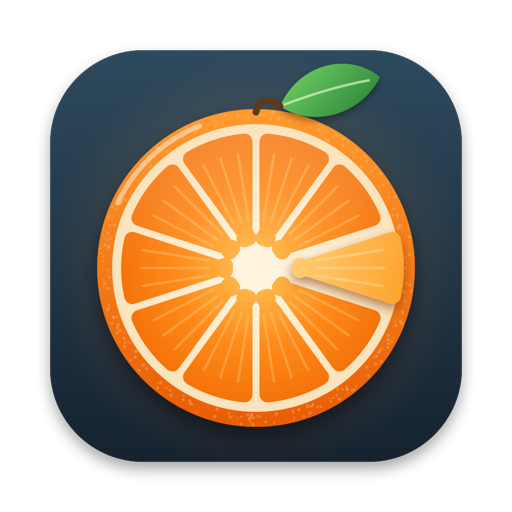

<h1 align="center">Clementine</h1>

Converti, comprimi e ottimizza i file trascinandoli · macOS 15 o successivo 
Convert, compress and optimise files by dragging them · macOS 15 or later

<a href="https://github.com/alecensi82/Clementine/releases/latest/download/Clementine.dmg"><b>⬇︎ Scarica Clementine / Download Clementine</b></a>

<a href="CHANGELOG.md">Novità di ogni versione / What's new in each version</a>

---

## Italiano

Clementine vive nella barra dei menu. Trascini un file, premi **⌃ Control** (o un tasto del mouse) e sotto il puntatore si apre una **ruota a spicchi** con le azioni adatte a quel file: lo rilasci sullo spicchio e il gioco è fatto.

- **Ruota di conversione**: spicchi colorati per categoria (Converti, Modifica, PDF, Archivio, File), con suono e feedback aptico mentre passi da uno all'altro. Si apre con ⌃, ⇧, fn o ⌃⇧, oppure con un tasto del mouse (centrale, Indietro, Avanti).
- **Ottimizza**: riduce JPEG, PNG e GIF senza perdita di qualità e **riscrive lo stesso file**, solo se il risultato è più piccolo e identico per dimensioni, colori e orientamento. Nome, cartella, tag del Finder e date restano quelli.
- **Immagini**: PNG, JPG, HEIC, WebP, TIFF, GIF, BMP e PDF · comprimi · ridimensiona · rimuovi metadati (GPS, EXIF) · leggi codici QR · copia il testo (OCR).
- **Video**: MP4, MOV, GIF, estrai l'audio · comprimi · togli l'audio · rimuovi metadati · salva un fotogramma · taglia.
- **Audio**: M4A, WAV, AIFF (con ffmpeg anche MP3, FLAC, OGG) · taglia · normalizza il volume.
- **PDF**: unisci · pagine in PNG o JPG · Word · testo · comprimi · dividi · ruota · rimuovi metadati.
- **Documenti**: DOCX, RTF, ODT, HTML, TXT e Markdown, convertibili tra loro e in PDF.
- **Archivi**: crea ZIP · estrai zip, rar, 7z, tar, gz.
- **Float**: un ripiano galleggiante dove parcheggiare i file e trascinarli altrove, anche tutti insieme.
- **Strumenti**: una finestra con tutte le azioni e le opzioni (compressione, dimensioni, intervallo di taglio).

Tranne «Ottimizza», ogni azione crea un **file nuovo** accanto all'originale (o in Download), che non viene toccato. Tutto avviene sul tuo Mac: nessun file viene inviato in rete.

### Installazione
1. Scarica **Clementine.dmg** dalla pagina [Releases](../../releases/latest).
2. Aprilo e trascina **Clementine** in **Applicazioni**.
3. Avviala: compare l'icona del mandarino nella barra dei menu.

L'app è firmata con Developer ID e notarizzata da Apple: si apre senza avvisi.

### Licenza
Clementine è **libera e gratuita**: usala, copiala e condividila con chi vuoi, così com'è e senza farla pagare. Non si può vendere né noleggiare. Vedi [LICENSE.txt](LICENSE.txt). Gli strumenti di ottimizzazione inclusi (jpegoptim, mozjpeg, oxipng, zopflipng, pngquant, gifsicle) restano soggetti alle proprie licenze, elencate nell'app.

---

## English

Clementine lives in the menu bar. Drag a file, press **⌃ Control** (or a mouse button) and a **segmented wheel** opens under the pointer with the actions that suit that file: drop it on a segment and you're done.

- **Conversion wheel**: segments coloured by category (Convert, Edit, PDF, Archive, File), with a sound and haptic tick as you move between them. Opens with ⌃, ⇧, fn or ⌃⇧, or with a mouse button (middle, Back, Forward).
- **Optimise**: shrinks JPEG, PNG and GIF losslessly and **rewrites the same file**, only if the result is smaller and identical in size, colours and orientation. Name, folder, Finder tags and dates stay the same.
- **Images**: PNG, JPG, HEIC, WebP, TIFF, GIF, BMP and PDF · compress · resize · strip metadata (GPS, EXIF) · read QR codes · copy text (OCR).
- **Video**: MP4, MOV, GIF, extract audio · compress · remove audio · strip metadata · save a frame · trim.
- **Audio**: M4A, WAV, AIFF (MP3, FLAC, OGG with ffmpeg) · trim · normalise volume.
- **PDF**: merge · pages to PNG or JPG · Word · text · compress · split · rotate · strip metadata.
- **Documents**: DOCX, RTF, ODT, HTML, TXT and Markdown, convertible to each other and to PDF.
- **Archives**: create ZIP · extract zip, rar, 7z, tar, gz.
- **Float**: a floating shelf to park files and drag them elsewhere, even all at once.
- **Tools**: a window with every action and its options (compression, size, trim range).

Except «Optimise», every action creates a **new file** next to the original (or in Downloads), which is left untouched. Everything happens on your Mac: no file is sent over the network.

### Installation
1. Download **Clementine.dmg** from the [Releases](../../releases/latest) page.
2. Open it and drag **Clementine** to **Applications**.
3. Launch it: the clementine icon appears in the menu bar.

The app is signed with Developer ID and notarised by Apple: it opens without warnings.

### Licence
Clementine is **free**: use it, copy it and share it with anyone, unchanged and free of charge. It may not be sold or rented. See [LICENSE.txt](LICENSE.txt). The bundled optimisation tools (jpegoptim, mozjpeg, oxipng, zopflipng, pngquant, gifsicle) remain under their own licences, listed in the app.
